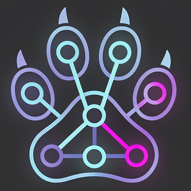

<div align="center">



# git-paw

**Parallel AI Worktrees** — run several AI coding CLIs side by side, one git worktree and one tmux pane per branch.

[](https://github.com/bearicorn/git-paw/actions/workflows/ci.yml)
[](https://crates.io/crates/git-paw)
[](https://crates.io/crates/git-paw)
[](LICENSE)
[](Cargo.toml)

</div>

## What it does

You pick branches and an AI CLI for each; git-paw creates a worktree per branch and opens a tmux session with one agent pane per worktree. Stop and resume at will: worktrees, uncommitted work and session state survive.

## Demo

```
$ git paw
  Select branches (type to filter, space to toggle, enter to confirm)
  > [x] feat/api
    [x] feat/auth
    [ ] main
  CLI assignment mode:
  > Same CLI for all branches
    Different CLI per branch
  Select AI CLI for all branches:
  > Claude (claude)
    Codex (codex)

  # creates a worktree per branch, opens tmux session paw-myproject, attaches you
```

## Highlights

- **Parallel worktrees in tmux** — one worktree and pane per branch, with presets, `--dry-run` and session logs. See [Introduction](docs/src/introduction.md).
- **Per-branch CLIs** — Claude on one branch, Codex on another; a `[clis.<name>]` entry with `family` inherits a known CLI's flags, resume and MCP form. See [Provider families](docs/src/supported-clis.md#provider-families).
- **Agent profiles** — name what an agent is for: a worker profile pins a CLI's model args, approval level and role skill for `--profile`, specs and the picker; a delegate profile runs a one-shot headless auditor or explorer through `git paw delegate`. See [Agent profiles](docs/src/user-guide/agent-profiles.md).
- **Spec-driven launch** — one worktree per pending spec from OpenSpec, Spec Kit, Superpowers or plain Markdown (`--from-all-specs`, `--specs`). See [Spec-driven launch](docs/src/user-guide/spec-driven-launch.md).
- **Runtime isolation** — per-worktree env files, port blocks and `on_create` / `on_remove` hooks, so agents run dev servers side by side. See [Runtime isolation](docs/src/user-guide/runtime-isolation.md).
- **Orchestrator mode** — your own agent drives the session through the exported skill, the broker and the dashboard, with conflict detection, verified sends (`sweep.sh tell`) and opt-in learnings. See [Orchestrator quick start](docs/src/quick-start-orchestrator.md), [Conflict detection](docs/src/user-guide/conflict-detection.md) and [Learnings](docs/src/user-guide/learnings.md).
- **Unattended runs** — `start --unattended` drives a wave to completion, escalates every permission prompt to a human, approves none, and stops dispatching at an optional usage budget. See [Unattended mode](docs/src/user-guide/supervisor.md#unattended-mode---unattended).
- **MCP server** — `git paw mcp` serves repository and session state to any MCP client over stdio. See [MCP server](docs/src/user-guide/mcp.md).
- **Doctor and recovery** — `git paw doctor` diagnoses a failed launch; `start` recovers a session after a crash or reboot. See [Doctor](docs/src/user-guide/doctor.md) and [Session lifecycle](docs/src/user-guide/session-lifecycle.md).
- **Sandboxed workers** — run a CLI under your own sandbox wrapper or its native sandbox to confine writes to the worktree; declare it with `sandbox = "wrapper"` or `"native"` so `doctor` reports it. See [Sandbox](docs/src/user-guide/sandbox.md).

## Install

```bash
cargo install git-paw                      # crates.io
brew install bearicorn/tap/git-paw         # Homebrew
curl --proto '=https' --tlsv1.2 -LsSf https://github.com/bearicorn/git-paw/releases/latest/download/git-paw-installer.sh | sh
```

Requires tmux and Git 2.5+, on macOS or Linux; on Windows, use WSL. See [Installation](docs/src/installation.md).

## Quick start

```bash
git paw init                                            # set up .git-paw/ and config
git paw                                                 # pick branches and CLIs interactively
git paw start --cli claude --branches feat/auth,feat/api
# pick "Different CLI per branch" in `git paw` to mix CLIs
git paw start --supervisor                              # orchestrator mode
git paw start --unattended --from-all-specs             # run every pending spec to completion
```

Walkthroughs: [same CLI](docs/src/quick-start-same-cli.md), [per-branch CLI](docs/src/quick-start-per-branch.md), [orchestrator mode](docs/src/quick-start-orchestrator.md).

## Commands

| Command | What it does |
|---------|--------------|
| `init` | Create `.git-paw/`, config and `.gitignore` entries; install every bundled skill package under `.git-paw/skills/` (the orchestrator and cli-setup skills, and every helper); add the orchestrator pointer to `AGENTS.md`. A re-run backfills new config fields. |
| `start` | Launch, reattach or recover a session: interactive, `--cli`/`--profile`/`--branches`, `--preset` or spec-driven. |
| `add` / `remove` | Attach or detach one branch and its agent pane in a live session (`add --profile` picks a worker profile). |
| `delegate` | Run a delegate profile once, headless, at the repository root, and print its compact result. |
| `pause` / `stop` | Pause keeps CLI panes for a fast resume; stop ends the session and keeps worktrees and state. |
| `purge` | Remove the session, worktrees and state; delete only merged branches git-paw created. |
| `status` | Show the session, branches, CLIs and state (`--json` adds per-worker usage). |
| `attach` | Reattach the terminal to this repository's running session. |
| `list-clis` / `add-cli` / `remove-cli` | Manage detected and custom AI CLIs. |
| `setup-cli` | Pre-approve git-paw's helper calls in one CLI's own settings, with `--undo`. |
| `replay` | View session logs. |
| `approvals` | List the permission prompts the unattended loop escalated; git-paw approves none. |
| `mcp` | MCP server over stdio: read-only state, publish and verdict tools, and opt-in spec authoring. |
| `doctor` | Read-only preflight checks with a remedy for each finding. |
| `completions` | Print a shell completion script (bash, zsh, fish, elvish, powershell). |

Every flag and example: [CLI reference](docs/src/cli-reference.md).

## Configuration

Per-repository `.git-paw/config.toml` overrides the global config: `~/.config/git-paw/config.toml` on Linux, `~/Library/Application Support/git-paw/config.toml` on macOS.
Every field and default: [Configuration reference](docs/src/configuration/README.md).

## Supported CLIs

Auto-detected on your PATH: `claude`, `codex`, `agy`, `aider`, `vibe`, `qwen`, `amp`, `opencode`, `cline`, `droid`, `pi`, `junie`, `cursor-agent`, `copilot`, `cn`, `kilo`, `kimi`.
Register any other CLI with `git paw add-cli`. See [Supported CLIs](docs/src/supported-clis.md).

## Security

- Agents run arbitrary code with your user's privileges.
- git-paw approves no permission prompt; the agent CLI's own permission system and your allow rules decide.
- An optional, opt-in sandbox confines an agent's writes to its worktree.
- Claude-family workers launch without your user-level settings, hooks, plugins or auto memory — see [what a worker inherits](docs/src/user-guide/security-posture.md#what-a-worker-inherits-from-you).

Read the [Security posture](docs/src/user-guide/security-posture.md) and [Sandbox](docs/src/user-guide/sandbox.md) pages before an autonomous run.

## Documentation

- [User guide](https://bearicorn.github.io/git-paw/)
- [Changelog](CHANGELOG.md)
- [FAQ](docs/src/faq.md)

## Contributing

See [CONTRIBUTING.md](CONTRIBUTING.md).

## License

[MIT](LICENSE) — Copyright 2026 bearicorn
